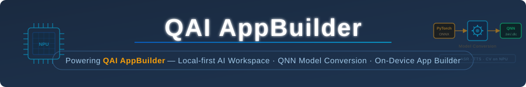

 

  

 

  
  
  
  
  
  
  

 

---

### Get Started with QAI AppBuilder

> **QAI AppBuilder** is the natural-language Agent platform where the App Builder,
> Model Builder, and AI Hub Model Run capabilities all live. Grab the installer or code package
> below and you'll have a running, on-device AI app builder in minutes. Here is the full
> introduction — [docs/Introduction.md](docs/Introduction.md).
>
> **On Windows**, just download the EXE installer (`*-setup.exe`, available for ARM64 and x64)
> from the release page and run it — no manual environment setup is needed.
>
> QAI AppBuilder is provided "as is", without warranty of any kind — please evaluate it for your
> use case and test thoroughly before relying on it in critical systems.

  
  &nbsp;&nbsp;
  

 

> ## 🎁 Sign in and get **10 million free tokens**
>
> **Just sign in with your Qualcomm account to unlock a free allocation of 10 million tokens and start using QAI AppBuilder.** No separate API key is required to try the built-in cloud AI experience. 🚀
>
> ✨ **One account. 10M tokens. Start building.**
