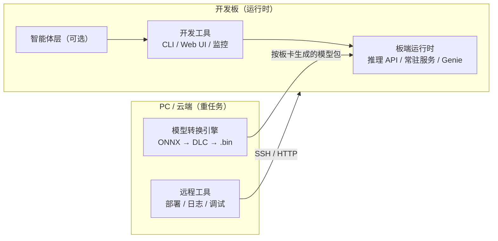
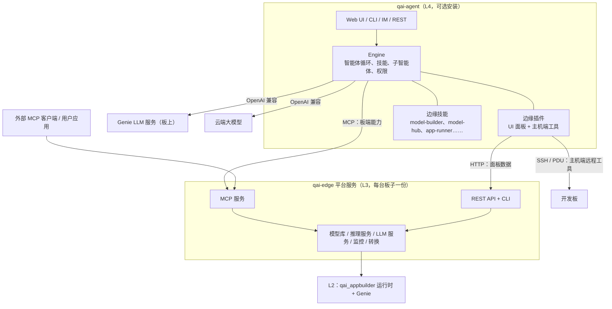

# 基于 QAI AppBuilder 的高通边缘 AI 开发平台设计

> **状态**：草案 v0.2（2026-09-30；第 5 章改为"qai-agent 独立作为智能体层"）
>
> **适用范围**：高通 arm64 Linux 开发板，包括 Ride5、RRD、Radxa、8550 等
>
> **前置文档**：[Linux 功能对等表](../tools/qaiappbuilder/docs/linux-feature-parity.md)
>
> **依据与局限**：本文基于代码阅读整理，**没有在板子上实测过**。凡是写着"待验证"的结论，都要以真机结果为准。

---

## 1. 对标 Jetson

### 1.1 Jetson 为什么好用

Jetson 的价值不在于某一个工具，而在于一整套"拿到板子就能跑"的体验：

| 层次 | Jetson 提供的内容 | 开发者得到的体验 |
|---|---|---|
| 系统镜像 | JetPack：L4T + CUDA/cuDNN/TensorRT，一次刷机全部装好 | 不用自己拼驱动和运行库版本 |
| 运行时 | TensorRT、DeepStream、Triton | 板子上直接推理、跑视频管线、跑常驻服务 |
| 模型 | NGC 和 jetson-containers 按设备提供的镜像和模型 | 下载就能用，不用自己转换 |
| 应用样例 | jetson-inference、Hello AI World | 摄像头进、结果出，几分钟跑通 |
| 设备工具 | `jtop`、`tegrastats`、`nvpmodel` | 看得到负载、温度、功耗，能切换功耗模式 |
| 开发方式 | 在板子上开发为主，PC 上交叉编译为辅 | 板子本身就是开发机 |

### 1.2 高通侧已有能力对照

| Jetson 能力 | 高通对应物 | 平台现状 |
|---|---|---|
| JetPack | QAIRT SDK + BSP（Ubuntu / Qualcomm Linux / 车载 BSP） | SDK 可以用 `setup.sh` 装到 `~/qairt/<version>`，但没有按板卡分的安装配置 |
| TensorRT | QNN HTP backend + context binary（`.bin`） | 已有 C++/pybind 封装（[`src/`](../src/)、[`pybind/`](../pybind/)） |
| TensorRT-LLM / 本地大模型 | Genie | 有 C++ 版 GenieAPIService（带 [`build_linux.sh`](../samples/genie/c++/Service/build_linux.sh)）和 [Python 版](../samples/genie/python/GenieAPIService.py)，但管理层写死了 `.exe` |
| DeepStream | GStreamer + qtimlsdk 插件（Qualcomm Linux 自带） | 平台没有集成 |
| Triton | 无 | 缺失，需要补上常驻推理服务 |
| NGC 模型 | AI Hub 模型（按 SoC 编译） | 内置模型包只针对 X Elite v73 |
| `jtop` | `/sys` 下的温度、频率节点，以及 QNN profiling | 缺失 |
| Hello AI World | [`samples/`](../samples/) | 以 Windows 为主，没有摄像头类样例 |

### 1.3 差异化定位

平台不照搬 Jetson，而是在"Jetson 式的板端体验"之上加一层 AI 交互：

- **底座**是确定性的运行时、工具和模型库，和 Jetson 对等。
- **上层**是 AI 智能体，可以用自然语言完成转换、部署、调试。qai-appbuilder 和 qai-agent 都有这方面的积累，平台最终只采用其中一个作为智能体层（见第 5 章）。
- **原则**：每项能力都必须能不经过 AI、直接用 CLI、接口或 UI 完成，同时开放成 MCP 服务供 AI 调用（见 3.2）。

---

## 2. 需求

### 2.1 目标用户与场景

| 用户 | 典型场景 | 最看重 |
|---|---|---|
| 视觉 / IoT 开发者 | 摄像头 → 检测/分割 → 结果推送 | 视频管线、延迟、稳定常驻 |
| 大模型 / 多模态开发者 | 本地大模型对话、语音助手、VLM | Genie、模型下载、OpenAI 兼容接口 |
| 车载评估工程师（Ride5 / RRD） | 在车载 BSP 上评估模型性能 | PC 端转换、板端基准测试、不改动 BSP |
| 方案 / 售前 | 快速演示 | 开箱即用的样例和 Web UI |

> 首批主推哪一类用户还没定，见第 7 章 Q2。

### 2.2 功能需求

| 编号 | 需求 | 优先级 | 现状 |
|---|---|---|---|
| F1 | 一条命令完成板端安装，按板卡自动选择 SDK、HTP 架构和运行库 | P0 | `setup.sh` 可用，但没有板卡配置 |
| F2 | 按板卡提供可以直接运行的模型库（`.bin` + 元数据） | P0 | 缺失 |
| F3 | 板端推理 API：Python / C++，加载 `.bin` 后执行推理 | P0 | 已有（`qai_appbuilder` 包） |
| F4 | 常驻推理服务：HTTP/gRPC，支持多模型、并发、热加载 | P0 | App Builder 有常驻 Worker，但没有对外服务 |
| F5 | Linux 本地大模型服务（Genie） | P0 | 管理层写死 `.exe`，需要改造 |
| F6 | 模型转换：ONNX/PyTorch → 目标板卡的 `.bin`，按板卡名指定目标 | P0 | Model Builder 有流程，但目标以 SoC 参数表达，没有验证 |
| F7 | 设备监控：NPU/CPU 负载、温度、内存、功耗 | P1 | 缺失 |
| F8 | 摄像头和视频管线（GStreamer），支持推理节点 | P1 | 缺失 |
| F9 | 应用 SDK 与样例：检测、分割、ASR、TTS、LLM 对话 | P1 | 部分样例只在 Windows 上验证过 |
| F10 | 远程开发：从 PC 部署、调试、查看日志 | P1 | 远程部署已有（Paramiko） |
| F11 | AI 智能体：自然语言驱动 F1–F10 | P1 | qai-appbuilder 和 qai-agent 各有一套，需要选定一个并改成调用平台服务（见第 5 章） |
| F12 | 服务化：systemd、开机自启、升级、卸载 | P1 | 缺失 |

### 2.3 非功能需求

| 类别 | 要求 |
|---|---|
| 兼容性 | 首批 4 类板卡，覆盖 Ubuntu 和至少一种 Yocto 系系统（Qualcomm Linux 或车载 BSP） |
| 资源 | 板端核心运行时（不含 Web UI 和智能体）常驻内存 < 200 MB；Web UI 和智能体可选安装 |
| 离线 | 在没有外网的情况下，板端推理、模型库（本地缓存）和监控都能用 |
| 安全 | 默认只监听 127.0.0.1；远程访问必须认证；服务以低权限用户运行 |
| 可测试 | 每块首批板卡都有真机 CI（冒烟测试 + 模型库回归） |
| 可演进 | 平台底座（L1–L3）以现有代码为基础演进，不另起炉灶；智能体层只保留一套 |

---

## 3. 总体架构

### 3.1 部署形态

平台以**板上运行**为主，和 Jetson 一致，拆成三块：



| 模块 | 放在哪 | 理由 |
|---|---|---|
| 板端运行时 | 板子 | 推理必须在目标 NPU 上跑 |
| 开发工具（CLI、Web UI、监控） | 板子为主，也可在 PC 上远程访问 | 和 Jetson 一样，板子就是开发机 |
| 模型转换、量化 | PC 或云端为主，板上可选 | 量化和编译吃内存和 CPU；部分 SDK 工具只有 x86_64 版本 |
| 智能体 | 板子或 PC | 依赖云端大模型时放哪都可以；使用本地 Genie 时放在板子上 |

**车载 BSP 例外**：Ride5、RRD 如果用的是车载 BSP（只读根文件系统、没有包管理器、没有 Python 3.12），采用"PC 开发 + 板子运行时"方式：板子只部署最小运行时（C++ 推理库、推理服务可执行文件、模型包），Web UI、智能体和转换都放在 PC 上，通过远程工具操作。

### 3.2 分层

```
┌───────────────────────────────────────────────────────────────┐
│ L4 交互层     Web UI │ CLI (qai) │ AI 智能体 │ 外部 MCP 客户端    │
├───────────────────────────────────────────────────────────────┤
│ L3 平台服务   模型库 │ 模型转换 │ 推理服务 │ LLM 服务 │ 监控 │ 部署 │
│              （每个服务 = 领域逻辑 + REST + CLI + MCP 工具）       │
├───────────────────────────────────────────────────────────────┤
│ L2 板端运行时 qai_appbuilder (C++/pybind) │ Genie │ GStreamer 插件 │
├───────────────────────────────────────────────────────────────┤
│ L1 设备层     QAIRT 运行库（每台设备一份）│ FastRPC │ BSP / 驱动     │
└───────────────────────────────────────────────────────────────┘
```

设计约束：

1. **AI 不是底座**。L3 的每个服务都先有确定性的接口（REST + CLI），MCP 工具只是这些接口的薄封装。智能体通过 MCP 调用，和外部客户端（Claude Desktop、IDE 等）走同一条路径。
2. **板端 API 和主机端远程工具要分开**。板端 API 只操作本机资源；远程工具在 PC 上运行，通过 SSH 或 HTTP 调用板端 API。两者的命令名和参数保持一致，但不要混在一个进程里。
3. **运行库每台设备装一份**。QAIRT 运行库（`libQnnHtp.so`、`libQnnHtpV*Skel.so` 等）由 L1 按板卡安装，模型包里只放 `.bin` 和元数据，不重复打包运行库。
4. **L2 只依赖 L1，L3 只依赖 L2**。车载 BSP 上可以只装 L1 + L2 + 推理服务。

### 3.3 独立底座（微内核）与多上层解耦设计

为了保证平台底座（`qai-edge`）能**无缝且随意地被移植或挂接到不同的上层生态**（如 `qai-agent`、`Model Builder`、`qai-appbuilder` 或客户独立的 IoT 程序），底座设计必须遵循**微内核解耦规范**：

```
┌────────────────────────────────────────────────────────────────────────┐
│  可插拔的上层宿主（按需挑选，互不干扰）                                │
│                                                                        │
│  [qai-agent 智能体]   [Model Builder]   [qai-appbuilder]  [IoT 业务]   │
│  (MCP Client 挂接)     (Python SDK 导入) (REST 反向代理)  (C++/CLI 调用)│
└───────────────────────────────────┬────────────────────────────────────┘
                                    │ 统一标准导出界面：
                                    │ 1. Python SDK (`import qai_edge`)
                                    │ 2. 命令行 (`qai ...`)
                                    │ 3. REST API (FastAPI 微服务)
                                    │ 4. 标准 MCP Server (stdio / SSE)
┌───────────────────────────────────┴────────────────────────────────────┐
│  qai-edge 独立开发底座（纯确定性、零 AI 依赖、无 Web 前端）             │
│                                                                        │
│  ├── 板卡与硬件探测 (board / host)：SoC, HTP 架构, FastRPC, 监控节点   │
│  ├── 运行库管理 (env / qairt)：版本校验, 软链接修复, 环境注入          │
│  ├── 模型包中心 (model)：Manifest 解析, 按板卡下载, 完整性校验         │
│  ├── 运行时与常驻推理 (runtime)：包装底层 pybind/C++, 类似 Triton 服务 │
│  ├── 本地 LLM 服务托管 (llm)：Genie 进程生命周期守护, OpenAI 兼容代理 │
│  └── 确定性转换驱动 (convert)：ONNX -> DLC -> .bin, 基于板卡配置       │
└────────────────────────────────────────────────────────────────────────┘
```

#### 3.3.1 底座设计的四大红线（不可违背）

1. **零 AI 依赖（Zero-AI Dependency）**：
   - 底座包内部绝对不能 `import` 任何大模型、Prompt 编排或智能体框架（如 LangChain、qai-agent 核心代码等）。
   - 所有的功能逻辑（如模型转换、编译、推理、测试）都是 100% 确定性的程序，输入明确、输出明确。
2. **极简轻量依赖**：
   - 仅依赖 Python 标准库和极少数成熟的基础轮子（`pydantic`、`psutil`、`fastapi`、`pyyaml`、底层 `pybind11` 推理扩展）。
   - 绝不引入 Node.js、前端构建工具链或复杂大型 ORM。
3. **无状态与轻量状态存储**：
   - 配置全部采用声明式 YAML/JSON，状态保存在内存或本地轻量文件锁中，确保在嵌入式或只读文件系统下也能通过临时目录启动。
4. **统一的多通道导出能力**：
   - 底座每实现一个能力，必须同时通过 Python API、CLI、REST 和 MCP 四个通道暴露，禁止在某个通道里私藏业务逻辑。

#### 3.3.2 上层宿主的挂接与移植方式

不同上层集成 `qai-edge` 时，采用适合其形态的最优通道，底座代码无需作任何改动：

| 上层宿主 | 挂接机制 | 具体实施方式 |
|---|---|---|
| **qai-agent** | **标准 MCP Server** + **WebUI 插件** | • 在 qai-agent 的 `config.json` 或 `mcp.json` 中配置以 `stdio` 方式启动 `python -m qai_edge.mcp`，即刻获得所有板端工具。<br/>• 若需在 qai-agent WebUI 中呈现硬件监控仪表盘或模型列表，编写符合 qai-agent 规范的前端 Vue 插件面板，直接调用 `qai-edge` 的 REST API。 |
| **Model Builder** | **Python SDK** 或 **CLI 子进程** | • Model Builder 将 `qai-edge` 作为依赖库引入：`from qai_edge.board import get_board_profile`，直接获取目标板卡的芯片型号、HTP 版本、算子支持清单。<br/>• 转换与量化执行直接调用 `qai_edge.convert.compile_model(...)`，把转换结果直接导出为标准模型包。 |
| **qai-appbuilder** | **REST 代理** 或 **MCP 客户端** | • 作为已有 Windows/Web 产品的后端扩展，前端发起的请求由 API 路由转发给 `qai-edge` 的 REST 接口；或者直接注册为 qai-appbuilder 的 MCP 外部工具源。 |
| **纯终端与嵌入式工程** | **CLI** 与 **C++/Python SDK** | • 开发者在开发板通过 `qai run <model>`、`qai monitor` 交互。<br/>• 客户工控/车载程序直接把常驻推理服务（HTTP/UDS）作为本地推理引擎接入。 |

### 3.4 核心概念

#### 板卡配置（Board Profile）

所有"按板卡"的行为都由板卡配置驱动，它是整个平台的唯一事实来源：

```yaml
# boards/rb8.yaml（示例，字段待定）
id: rb8
display_name: "Qualcomm RB8 (QCS9075)"
soc: qcs9075
htp_arch: v73
dsp_arch: v73
os: [ubuntu-24.04, qcom-linux-1.x]
qairt:
  min_version: "2.38"
  lib_dir: aarch64-ubuntu-gcc9.4      # 或 aarch64-oe-linux-gcc11.2
  skel_dir: hexagon-v73/unsigned
capabilities: [htp, gpu, camera, genie]
monitor:
  thermal_zones: [...]
  npu_freq_node: ...
```

首批板卡：Ride5、RRD、Radxa、8550。每块板卡具体对应哪颗 SoC、哪个系统，见第 7 章 Q1，确认之后才能填写。

#### 模型包（Model Package）

```
<model>-<board>-<precision>/
├── manifest.json     # 模型名、版本、目标板卡/SoC/htp_arch、QAIRT 版本、输入输出、sha256
├── model.bin         # context binary
├── preprocess.py     # 可选，前后处理
└── README.md
```

- `.bin` **和 SoC、HTP 架构、QAIRT 版本绑定**，不能在运行时切换 backend。需要 GPU/CPU 回退时，要单独提供 DLC 或另一个包，由 manifest 声明。
- 加载前按 manifest 校验板卡和 QAIRT 版本；不匹配时直接报错并提示去哪里下载兼容的包，不要等到 QNN 加载失败再抛出看不懂的错误。

### 3.5 关键数据流

**A. 下载即用**：`qai model pull yolov8-det --board rb8` → 模型库按板卡配置匹配 → 下载并校验 → `qai run` 或推理服务加载。

**B. 自带模型**：PC 上执行 `qai convert model.onnx --board rb8 --precision w8a16` → 转换引擎读取板卡配置得到 SoC、htp_arch → 产出模型包 → `qai deploy --host <board>` → 板端推理服务热加载。

**C. 视频管线**：摄像头（`qtiqmmfsrc` / v4l2）→ GStreamer → 推理节点（调用 L2）→ 叠加或推送结果。

**D. 本地大模型**：Genie 服务在板上常驻，对外提供 OpenAI 兼容接口；Web UI、智能体和用户应用都按"一个普通的 OpenAI 服务商"来接入。

---

## 4. 与 qai-appbuilder 的集成

### 4.1 模块对照

| 平台模块 | 现有代码 | 结论 | 需要做的事 |
|---|---|---|---|
| L1 安装与板卡配置 | [`tools/qaiappbuilder/setup.sh`](../tools/qaiappbuilder/setup.sh)、[`tools/launcher_linux/`](../tools/launcher_linux/) | 演进 | 引入板卡配置；按配置选择 `lib_dir` / `skel_dir`；合并两套 Linux 启动脚本 |
| L2 推理运行时 | [`src/`](../src/)、[`pybind/`](../pybind/)（`qai_appbuilder` 包） | 复用 | 增加 manifest 校验；aarch64 Linux wheel 纳入 CI |
| L2 Genie | [`samples/genie/c++/Service/`](../samples/genie/c++/Service/)（含 `build_linux.sh`）、[`samples/genie/python/GenieAPIService.py`](../samples/genie/python/GenieAPIService.py) | 复用 | 产出 aarch64 Linux 可执行文件的正式发布件 |
| L3 模型库 | [`src/qai/model_catalog/`](../tools/qaiappbuilder/src/qai/model_catalog/)、[`platform/download/`](../tools/qaiappbuilder/src/qai/platform/download/) | 演进 | 清单增加 `board` / `htp_arch` 维度；aria2c 在 Linux 上自动检测，缺失时回退到 HTTP 下载 |
| L3 模型转换 | [`src/qai/model_builder/`](../tools/qaiappbuilder/src/qai/model_builder/) | 拆分后演进 | 见 4.3 |
| L3 推理服务 | [`src/qai/app_builder/`](../tools/qaiappbuilder/src/qai/app_builder/)（常驻 Worker、运行、基准测试） | 演进 | 把常驻 Worker 抽成独立的推理服务进程，对外提供 REST；App Builder UI 改为调用它 |
| L3 LLM 服务 | [`src/qai/model_runtime/`](../tools/qaiappbuilder/src/qai/model_runtime/)、[`src/qai/service_release/`](../tools/qaiappbuilder/src/qai/service_release/) | 演进 | 见 4.4 |
| L3 部署 | [`src/qai/remote_deploy/`](../tools/qaiappbuilder/src/qai/remote_deploy/) | 复用 | 作为主机端远程工具；部署单位从"项目"扩展到"模型包" |
| L3 监控 | 无 | 新增 | 新增 `src/qai/device_monitor/`，按板卡配置读取 `/sys` 节点 |
| L3 视频管线 | 无 | 新增（P1） | GStreamer 推理插件 + 样例，先覆盖 Qualcomm Linux |
| L4 Web UI / CLI | [`frontend/`](../tools/qaiappbuilder/frontend/)、[`apps/cli/`](../tools/qaiappbuilder/apps/cli/)、[`apps/api/`](../tools/qaiappbuilder/apps/api/) | 演进 | 增加板卡、模型库、监控页面；CLI 增加 `model / convert / serve / monitor` 子命令 |
| L4 智能体 | [`src/qai/chat/`](../tools/qaiappbuilder/src/qai/chat/)、[`src/qai/tools/`](../tools/qaiappbuilder/src/qai/tools/)、技能 | 演进，或由 qai-agent 替代 | 保留时：智能体工具改为调用 L3 的 MCP 接口。采用 qai-agent 时：不再使用这部分代码，按第 5 章迁移功能 |
| 安全 | [`src/qai/security/`](../tools/qaiappbuilder/src/qai/security/)、[`command_policy/`](../tools/qaiappbuilder/src/qai/command_policy/) | 复用 + 补强 | 按平台能力注册工具（`computer` 在 Linux 上不暴露）；远程访问认证；systemd 低权限用户 |

### 4.2 演进方式

> 本节描述的是**保留 qai-appbuilder 智能体**时的做法。如果采用 qai-agent（第 5 章），L3 模块要从 `tools/qaiappbuilder` 中抽出，放到独立的平台服务包中，本节的模块对照作为迁移时的参考实现。

- **在现有模块上演进，不另起新平台**。现有代码已经按 `domain / application / adapters / infrastructure` 分层，新能力按同样的结构加到 `src/qai/` 下，复用配置、日志、事件、权限等平台基础设施。
- **每个 L3 服务的交付物固定为四件**：领域逻辑、REST 路由、CLI 子命令、MCP 工具定义。MCP 工具由 REST 路由自动生成或手写薄封装，禁止在 MCP 层写业务逻辑。
- **板端最小安装**：`setup.sh` 增加安装档位，例如 `--profile runtime | dev | full`：
  - `runtime`：L1 + L2 + 推理服务 + LLM 服务（无 Node.js、无前端）
  - `dev`：再加 CLI、监控、Web UI
  - `full`：再加智能体（qai-appbuilder 智能体，或 qai-agent + 边缘插件）和 Model Builder
- **兼容 Windows**：所有改造都不能破坏现有 Windows 路径。平台差异通过 `platform/` 下的能力探测来处理，不要在业务代码里写 `if sys.platform`。

### 4.3 Model Builder 的定位与拆分

Model Builder 是平台的**模型转换模块**，不是底座。目前"确定性的转换步骤"和"AI 驱动的流程编排"混在一起，需要拆开：

| 层 | 内容 | 调用方 |
|---|---|---|
| 转换引擎（确定性） | ONNX/PyTorch → DLC → `.bin`；量化；生成 manifest；输入为 `--board` 或 `--soc` | CLI、REST、CI、智能体 |
| AI 工作流 | 读模型、选算子替换方案、分析报错、重试 | 只有智能体 |

要点：

1. **按板卡名指定目标**：`--board rb8` 从板卡配置中解析出 `soc_model`、`dsp_arch`、QAIRT 版本；`--soc` 保留，给高级用户使用。
2. 转换引擎的输出**直接就是 3.3 定义的模型包**，可以直接 Promote 到模型库或 App Builder。
3. 转换引擎要能在 PC（x86_64 Linux / Windows）和板上（aarch64，可选）运行；板上转换列为"尽力支持"，不作为主路径。
4. 已知问题（qcs6490 做 QNN 量化报 `SocModel doesn't support FP16`）等板卡特有的坑，要写进板卡配置的 `quirks` 字段，由转换引擎自动绕开，不要依赖 AI 去"发现"。

### 4.4 Linux 本地大模型（Genie）改造

现状：GenieAPIService 本身已经有 Linux 构建脚本和 Python 实现，缺口在 qai-appbuilder 的**管理层**：

- [`platform/config/settings.py`](../tools/qaiappbuilder/src/qai/platform/config/settings.py) 中默认程序名为 `GenieAPIService.exe`
- [`model_runtime/infrastructure/process_service.py`](../tools/qaiappbuilder/src/qai/model_runtime/infrastructure/process_service.py) 中 `exe_name` 默认值为 `.exe`，Linux 上会跳过端口占用回收
- [`service_release/adapters/filesystem_installer.py`](../tools/qaiappbuilder/src/qai/service_release/adapters/filesystem_installer.py) 按 `bin/<version>/GenieAPIService.exe` 扫描；安装器用 `wmic` 探测进程

改造：

1. 程序名按平台解析（Windows 上是 `GenieAPIService.exe`，Linux 上是 `GenieAPIService`）。
2. 端口回收和进程探测改用 `psutil`，统一跨平台实现。
3. 发布件增加 `linux-aarch64` 版本，按板卡配置选择 QAIRT 运行库路径（`LD_LIBRARY_PATH`、`ADSP_LIBRARY_PATH`）。
4. 提供 systemd unit，作为 LLM 服务常驻运行。
5. LLM 模型同样按板卡发布（Genie 的 `.bin` 同样和 SoC 绑定）。

### 4.5 真机 CI

现状：[`ci.yml`](../.github/workflows/ci.yml) 明确排除了 `tools/**`，qaiappbuilder 的改动不会触发任何 CI。

计划：

1. 先为 `tools/qaiappbuilder` 增加 x86_64 / aarch64 Linux 的单元测试 job（GitHub 托管 runner 即可）。
2. 每块首批板卡注册一台 self-hosted runner，跑冒烟测试：`setup.sh --profile runtime` → 加载模型库中每个模型 → 推理 → 对比参考输出。
3. 板卡电源由 APC PDU 控制，卡死时自动重启；刷机和 QAIRT 部署用现有的板卡部署工具完成。
4. 模型库发布前必须通过对应板卡的回归测试。

### 4.6 平台地基整理（所有 Linux 工作的前置）

#### 4.6.1 为什么要先做

在 `tools/qaiappbuilder`（`src/`、`apps/`、`scripts/`，共 915 个 Python 文件）上做了一次清点：

| 现象 | 具体情况 |
|---|---|
| 平台判断分散 | 直接写 `sys.platform` / `os.name` / `platform.system()` 的地方有 **133 处，分布在 55 个文件**里；没有统一的平台能力模块，只有 [`workspace_lock.py`](../tools/qaiappbuilder/src/qai/ai_coding/infrastructure/workspace_lock.py)、[`filesystem_installer.py`](../tools/qaiappbuilder/src/qai/service_release/adapters/filesystem_installer.py) 等个别文件自己定义了 `is_windows` 局部变量 |
| 有共用进程层但没用满 | [`platform/process/`](../tools/qaiappbuilder/src/qai/platform/process/)（`tree_kill`、`kill_group`、`spawn_flags`、`subprocess_runner`）和 [`platform/background_process/`](../tools/qaiappbuilder/src/qai/platform/background_process/) 已经封装了跳平台逻辑，但 [`ai_coding/.../handlers/search.py`](../tools/qaiappbuilder/src/qai/ai_coding/infrastructure/tools/handlers/search.py) 又自己实现了一套 `_terminate_tree_windows`（`taskkill`）/ `_terminate_tree_posix`（`killpg`） |
| 进程探测不统一 | 全仓只有 2 处 `import psutil`；其余各自调 `wmic` / `taskkill` / `netstat`（[`process_service.py`](../tools/qaiappbuilder/src/qai/model_runtime/infrastructure/process_service.py) 中 7 处，[`background_process/kill.py`](../tools/qaiappbuilder/src/qai/platform/background_process/kill.py) 中 3 处） |
| Windows 专有代码相对集中 | 主要在 `ai_coding/`（[`exec.py`](../tools/qaiappbuilder/src/qai/ai_coding/infrastructure/tools/handlers/exec.py) 和 [`exec_diagnostics.py`](../tools/qaiappbuilder/src/qai/ai_coding/infrastructure/tools/handlers/exec_diagnostics.py) 里 PowerShell 字样出现 113 次）、[`platform/computer/win32/`](../tools/qaiappbuilder/src/qai/platform/computer/)、`service_release/`、`security/` |
| 能力判定方式不一致 | `computer` 工具只看配置开关（[`streaming.py:8570`](../tools/qaiappbuilder/src/qai/chat/application/use_cases/streaming.py) 附近），**不检查平台**；认证是否开启靠有没有 `DISPLAY` 推断，相当于把"有没有显示器"当成"是不是桌面环境" |
| 没有测试兜底 | `tools/qaiappbuilder/tests` 下只有约 10 个测试文件，CI 又排除了 `tools/**`（见 4.5） |

结论：Windows 专有代码并没有失控，大多集中在几个模块里。真正的问题是**没有统一的"平台能力"抽象，也没有 Linux 测试兜底**：每补一个 Linux 功能都要去各处找判断语句，改完了也不知道有没有改坏 Windows。

#### 4.6.2 要做的事（1–2 周）

只做下面五件，每件都直接服务于 M1：

| # | 内容 | 做法 | 输出 |
|---|---|---|---|
| G1 | **平台能力模块** | 新增 `src/qai/platform/host/`，统一提供：操作系统、CPU 架构、有无显示器（不再直接看 `DISPLAY`）、有无 Secret Service、有无 FastRPC 和 NPU、服务程序名后缀（`.exe` 或空）、默认 shell、QAIRT 运行库目录 | 一个只读的 `HostCapabilities` 数据结构，启动时探测一次并缓存；可以被测试替换 |
| G2 | **工具和页面按能力注册** | `computer` 等工具在不支持的平台上**根本不注册**（改 `streaming.py` 的门控和 [`tool_advertise.py`](../tools/qaiappbuilder/src/qai/chat/application/use_cases/tool_advertise.py)）；GenieAPIService 页面和 computer-automation 技能同样按能力决定是否显示 | 对等表中"交付前必须处理"的第 1、2 条清掉 |
| G3 | **进程管理收归** | `search.py` 和 `process_service.py` 里自己写的杀进程树、端口回收，改成调用 `platform/process/`；统一用 `psutil` 代替 `wmic` / `taskkill` / `netstat` | 一处实现，两个平台共用；Linux 上不再跳过端口回收 |
| G4 | **纳入 CI** | 先加 Linux x86_64 和 Windows 的单元测试 job（见 4.5 第 1 步），再给 G1、G3 补测试 | `tools/**` 不再是 CI 盗区 |
| G5 | **合并 Linux 启动脚本** | 把 [`tools/launcher_linux/`](../tools/launcher_linux/) 并入 [`setup.sh`](../tools/qaiappbuilder/setup.sh) / [`start.sh`](../tools/qaiappbuilder/start.sh)，改成按档位安装（见 4.2） | 板上安装只保留一条路径 |

#### 4.6.3 不做的事

| 不做 | 原因 |
|---|---|
| 不把 133 处平台判断一次改完 | 改动面太大、风险高。以后碰到哪个模块，就顺手把那个模块迁到 G1 上 |
| 不重写 `exec.py` 里的 PowerShell 逻辑 | 那是 Windows 端的核心体验，Linux 上本来就走 sh 分支，功能不缺。改它风险大、收益小 |
| 不为 guard64 做 Linux 对等实现 | 按原计划放到 M4，用 bubblewrap 或 Landlock 做沙箱 |
| 不做桌面应用和 `computer` 桌面操控的 Linux 版 | 保持"Linux 不提供"，由 G2 保证不会错误暴露 |

#### 4.6.4 与第 5 章的关系

G1、G2、G5 只在保留 qai-appbuilder 智能体时才有用。**G3、G4 在 qai-agent 路线下也不白做**：平台服务（L3）将来要从 `tools/qaiappbuilder` 抽出，有了统一的进程管理和测试，抽的时候会轻松很多。所以这一轮可以和 M0 的真机验证并行，不必等 Q3 定案；如果 Q3 倾向 qai-agent，就只做 G3、G4。

---

## 5. 以 qai-agent 作为智能体层

### 5.1 思路

如果采用 qai-agent，就**让它作为独立的 AI 智能体产品，不再基于 `tools/qaiappbuilder` 现有的代码**：

- **不做嵌入或混合**：不把 qai-agent 的 `Engine` 嵌进 qai-appbuilder 后端，也不让两套智能体核心并存。平台的 L4 智能体只有 qai-agent 一个。
- **按需迁移**：qai-appbuilder 里对边缘平台有用的**功能**迁移到 qai-agent 或平台服务中，迁移的是功能，不是代码。qai-agent 已经有的能力一律不迁移；只在 Windows 上有意义、或和边缘平台无关的功能也不迁移。
- **"脱离"的范围**：这里的"脱离"只针对 `tools/qaiappbuilder` 这个 Web 应用（后端、前端、智能体、工具、技能）。仓库根目录下的推理运行时（[`src/`](../src/)、[`pybind/`](../pybind/)，即 `qai_appbuilder` 包）和 [GenieAPIService](../samples/genie/c++/Service/) 属于 L2，仍然是平台底座，qai-agent 不替代它们。

采用这条路线后，分层变成：

| 层 | 组成 | 归属 |
|---|---|---|
| L4 交互层 | qai-agent（Web UI、CLI、IM 渠道、REST、pip 库）+ 边缘插件；平台 CLI | qai-agent 仓库 + agent-plugins |
| L3 平台服务 | 模型库、模型转换、推理服务、LLM 服务、监控 | **独立的平台服务包**（暂定名 `qai-edge`），和 AI 无关 |
| L2 / L1 | `qai_appbuilder` 运行时、Genie、QAIRT 运行库 | qai-appbuilder 仓库（不变） |

原则不变：**AI 不是底座**。L3 平台服务不能放进 qai-agent 插件里；插件只是 L3 的客户端。不装 qai-agent，平台照样能通过 CLI 和 REST 使用。

### 5.2 qai-agent 现状评估

| 维度 | 现状 | 对边缘平台的意义 |
|---|---|---|
| 智能体核心 | 多轮智能体循环、子智能体、多智能体讨论（[`roundtable.py`](../../qai-agent-code/qai-agent-main/qai_agent/orchestration/roundtable.py)）、三级上下文压缩、工具护栏、SQLite 会话持久化 | 已经够用，不用从 qai-appbuilder 迁移 |
| 交付形态 | Web UI、CLI、飞书/微信渠道、REST API、OpenCode 兼容后端、`pip install` 库（[`engine.py`](../../qai-agent-code/qai-agent-main/qai_agent/engine.py)） | 板上、PC 上都能部署；也能嵌入用户应用 |
| 内置工具 | `read` / `write` / `edit` / `exec` / `glob` / `grep` / `webfetch` / `Skill` / `task` / `todo` / `question` 等 | 覆盖 qai-appbuilder 的通用工具 |
| 技能 | `SKILL.md` + YAML front-matter，按需加载、热重载（[`skill_manager.py`](../../qai-agent-code/qai-agent-main/qai_agent/runtime/skill_manager.py)） | 和 qai-appbuilder 的技能格式接近，技能可以改写后迁移 |
| MCP | 作为 MCP 客户端，支持系统级和用户级两层配置 | 平台服务以 MCP 的形式接入 |
| 插件 | 插件可以同时提供 FastAPI 路由、智能体工具和 Vue 面板，支持热安装和卸载（[`plugin_manager.py`](../../qai-agent-code/qai-agent-main/qai_agent/runtime/plugin_manager.py)，[插件规范](../../qai-agent-code/qai-agent-dev/docs/design/plugin-specification.md)） | 边缘平台的 UI 页面和主机端工具都用插件实现 |
| 已有硬件插件 | [agent-plugins](../../qai-agent-code/agent-plugins/)：`board_deploy`（SSH 部署项目、部署 QNN SDK、上传文件）、`apc_controller`（PDU 电源控制）、`iq10_flat_build`、`iq10_flash_device` | 主机端远程工具已经有雏形，可以直接复用 |
| 安全 | `work_dir` 文件沙箱，分级权限策略（[`policy.py`](../../qai-agent-code/qai-agent-main/qai_agent/safety/policy.py)），manual / auto / plan 三种模式，破坏性命令硬拒绝；SSO 与多用户 | 应用层防护和 qai-appbuilder 相当；同样没有系统级拦截 |
| 本地大模型 | [`GenieProvider`](../../qai-agent-code/qai-agent-main/qai_agent/providers/genie_provider.py) 只是占位，直接抛 `NotImplementedError` | **必须补上** |
| NPU / 模型 / 板卡 | 核心里没有，只有上面那些插件 | 由 L3 平台服务 + 边缘插件补上 |
| CI | 只有一个 `self-hosted, Linux, X64` runner | 需要补 aarch64 真机 |

### 5.3 架构



**工具从哪里来**：同一个能力只能有一个入口，否则会出现两套工具定义。按下面的规则划分：

| 能力类型 | 例子 | 实现方式 | 原因 |
|---|---|---|---|
| **板端能力**（操作本机资源） | 查询模型库、拉取模型、运行推理、基准测试、加载 LLM、读取监控 | L3 平台服务的 **MCP 工具**，qai-agent 以 MCP 客户端身份接入 | 外部 MCP 客户端、用户应用和 qai-agent 走同一条路径；qai-agent 不管在板上还是在 PC 上都能用 |
| **主机端远程工具**（从 PC 操作板子） | 部署模型包、部署 SDK、上传文件、电源重启、刷机、查看远程日志 | qai-agent **插件**，通过 `ctx.register_tool` 注册 | 这类工具天然运行在 PC 上，也不属于板端 API；`board_deploy`、`apc_controller` 已经是这种形式 |
| **UI 页面** | 模型库、推理运行、LLM 服务、设备监控、板卡管理 | qai-agent **插件**的 Vue 面板，数据来自 L3 REST | 插件面板只是展示层，不在插件里写业务逻辑 |
| **AI 工作流** | 模型转换排错、算子替换、根据需求选择和串联模型 | qai-agent **技能** | 只有 AI 需要，底层步骤调用上面的 MCP 工具或 CLI |

### 5.4 部署形态

| 形态 | qai-agent 放在哪 | 平台服务 | 适用场景 |
|---|---|---|---|
| 板上一体 | 板子 | 同一块板子 | Ubuntu / Qualcomm Linux 开发板；使用本地 Genie，离线可用 |
| PC 驱动多板 | PC | 每块板子各一份，通过网络暴露 MCP / REST（需认证） | 实验室里一台 PC 管理多块板子；配合 PDU、刷机插件 |
| 车载 BSP | 只在 PC 上 | 板子上只有 L2 + 推理服务（C++ 可执行文件） | Ride5 / RRD 车载 BSP；智能体通过 SSH 或推理服务接口操作板子 |

qai-agent 在各形态下都是**可选**的：`setup.sh --profile full` 在板上安装 qai-agent 和边缘插件，`runtime` / `dev` 档位不安装。

### 5.5 功能迁移清单

判定规则：

- **不迁移**：qai-agent 已有等价能力，或者只在 Windows / 桌面上有意义。
- **迁到 L3**：确定性能力，放进 `qai-edge` 平台服务，并提供 REST + CLI + MCP 三种入口。
- **迁到插件 / 技能**：UI 页面、主机端工具做成插件；AI 工作流做成技能。
- **迁移方式**：以现有代码为参考**重写**，不照搬 qai-appbuilder 的 DDD 分层和平台基础设施（配置、事件、持久化等）。L3 用最简单的结构，插件和技能遵循 qai-agent 的规范。

| qai-appbuilder 功能 | 现有位置 | 结论 | qai-agent 路线下的形态 | 阶段 |
|---|---|---|---|---|
| 通用工具（文件、Shell、webfetch、子智能体、todo、question） | `src/qai/tools/` | 不迁移 | qai-agent 内置 | — |
| 技能系统、MCP 客户端 | `platform/skills/` 等 | 不迁移 | qai-agent 内置 | — |
| 多智能体讨论、Agent / Roster 模板 | `src/qai/chat/` | 不迁移 | qai-agent `roundtable` | — |
| 飞书等外部消息渠道 | `src/qai/channels/` | 不迁移 | qai-agent 已有飞书、微信 | — |
| API 密钥存储、SSO | `platform/crypto/`、认证模块 | 不迁移 | qai-agent `credential_store`、SSO；需要补无显示器板子上的远程认证 | M2 |
| 命令策略、Protected Paths、权限审批 | `src/qai/security/`、`command_policy/` | **规则**迁移 | 把边缘特有的保护规则（`/dev/fastrpc*`、QAIRT 安装目录、模型库目录、systemd 单元）写成 qai-agent 的策略配置；不迁移代码 | M2 |
| 平台能力探测（操作系统、架构、NPU、FastRPC、Secret Service） | 无（散在 133 处判断里，见 4.6） | 迁到 L3 | 由 L3 平台服务提供能力探测接口，qai-agent 通过 MCP 获取；不在智能体里重建 | M1 |
| App Builder：扫描模型包、运行、常驻 Worker、基准测试、历史、对比 | `src/qai/app_builder/` | 迁到 L3 + 插件 | L3 推理服务（常驻 Worker、运行、基准测试、MCP 工具）；插件 `edge_models` 提供运行和对比页面；运行历史存在 L3 | M1–M2 |
| 每个模型包的 `SKILL.md`（Whisper、MeloTTS 等） | `factory/chat_features/app-builder/models/` | 迁到技能 | 改为**从模型包 manifest 自动生成**，不再手写；跟随模型库按板卡发布 | M2 |
| LLM 编排多个模型包（`appbuilder_run`） | App Builder | 迁到技能 | 技能 `app-runner`：通过 MCP 工具串联模型 | M3 |
| 模型库、下载中心（aria2c、断点续传、sha256） | `model_catalog/`、`platform/download/` | 迁到 L3 + 插件 | L3 模型库服务（按板卡过滤）；插件提供浏览和下载页面 | M1 |
| model-hub 技能 | `factory/chat_features/model-hub/` | 迁到技能 | 改写为调用模型库 MCP 工具 | M1 |
| Model Builder 转换引擎 | `src/qai/model_builder/` | 迁到 L3 | 独立的转换 CLI / 服务，支持 `--board`（见 4.3） | M2 |
| Model Builder AI 工作流及 6 个排错子技能 | `factory/chat_features/model-builder/` | 迁到技能 | 保留排错知识，工具调用改为转换 CLI / MCP；工具名按 qai-agent 调整 | M2 |
| GenieAPIService 管理（启停、加载模型、配置、日志、安装发布件） | `model_runtime/`、`service_release/` | 迁到 L3 + 插件 | L3 LLM 服务（systemd 托管，见 4.4）；插件 `edge_llm` 提供管理页面；**不移植** Windows 专有的安装和进程探测逻辑 | M1 |
| 远程部署 | `src/qai/remote_deploy/` | 合并 | 合并进现有的 `board_deploy` 插件，增加"部署模型包"和"按板卡配置部署 QAIRT" | M2 |
| 设备监控 | 无 | 新增 | L3 监控服务 + 插件 `edge_monitor` | M2 |
| OpenAI 兼容接口（`/v1/chat/completions`） | `src/qai/chat/` | 不迁移 | 板上的 OpenAI 兼容接口由 Genie LLM 服务直接提供 | — |
| 定时任务、对话事件钩子 | `platform/scheduling/`、Hooks | 按需 | qai-agent 已有编程式 hooks；定时任务等有实际需求时再补 | 待定 |
| 浏览器自动化 | `platform/web_automation/` | 按需 | 边缘场景优先级低，可以作为可选插件 | 待定 |
| code-assist、ppt-gen 技能 | `factory/chat_features/` | 不迁移 | 和边缘平台无关；qai-agent 本身就能写代码 | — |
| `computer` 桌面操控、computer-automation 技能 | `platform/computer/` | 不迁移 | 只有 Win32 实现 | — |
| 桌面应用、guard64.dll | `desktop/` 等 | 不迁移 | 只在 Windows 上有意义 | — |

### 5.6 qai-agent 需要补的能力

| # | 内容 | 说明 | 阶段 |
|---|---|---|---|
| A1 | 实现 `GenieProvider` | Genie 服务兼容 OpenAI，可以基于 `openai_provider` 实现，再加上 `X-Genie-Client` 请求头、模型加载状态检查和上下文长度适配。本地小模型的工具调用能力较弱，需要对工具集做裁剪（见 7.2） | M1 |
| A2 | 边缘插件：`edge_models`、`edge_llm`、`edge_monitor`、`edge_boards` | 遵循插件规范：一个插件一个导航入口；长任务的状态放在后端；用户数据存到 `ctx.data_dir` | M1–M2 |
| A3 | 边缘技能包 | model-hub、model-builder（含排错子技能）、app-runner；随平台一起发布 | M1–M3 |
| A4 | 平台 MCP 服务的默认配置 | 安装时自动把本机的 `qai-edge` MCP 服务写入系统级 MCP 配置；PC 端支持按板卡添加远程 MCP 服务 | M2 |
| A5 | aarch64 Linux 支持验证 | 一键启动脚本在板子上的表现、依赖安装、内存占用；CI 增加 aarch64 真机 runner | M1 |
| A6 | 服务化 | systemd unit、低权限用户、日志轮转 | M2 |
| A7 | 远程访问与认证 | 板子上默认只监听 127.0.0.1；需要远程访问时强制开启认证（复用 qai-agent 的 SSO / 多用户） | M2 |
| A8 | 边缘安全策略 | 见 5.5 中的"命令策略"一行；评估 bubblewrap / Landlock 沙箱 | M2 / M4 |

### 5.7 对 qai-appbuilder 的影响

| 部分 | 处理方式 |
|---|---|
| 推理运行时（`src/`、`pybind/`）、GenieAPIService | 不变，作为平台 L2，继续由 qai-appbuilder 仓库维护和发布（包括 aarch64 Linux 版本） |
| `tools/qaiappbuilder` Web 应用 | 边缘平台**不再依赖**它。Windows 端产品是继续维护还是逐步转向 qai-agent，需要单独决策（见 7.1 Q3） |
| 第 4 章中 L3 模块的"演进" | 在这条路线下，L3 从 `tools/qaiappbuilder/src/qai/` **抽出**，放到独立的 `qai-edge` 包里，不再依赖 qai-appbuilder 应用的平台基础设施。第 4 章的模块对照仍然适用，作为迁移时的参考实现 |
| 4.6 的平台地基整理 | G3（进程管理收归）、G4（纳入 CI）仍要做，它们降低 L3 抽出的难度；G1（平台能力模块）、G2（工具按能力注册）、G5（合并启动脚本）可以跳过，改为在 `qai-edge` 和 qai-agent 中重新实现 |
| 第 1 章中 Linux 对等表的缺口 | 智能体相关的缺口（`computer` 工具、桌面应用、guard64）不再需要在 `tools/qaiappbuilder` 里修；平台相关的缺口（Genie、模型库、服务化）在 L3 中解决 |

### 5.8 与"保留 qai-appbuilder 智能体"的对比

| 维度 | 采用 qai-agent（本章） | 保留 qai-appbuilder 智能体（第 4 章路线） |
|---|---|---|
| 智能体核心 | 一套：qai-agent | 一套：`tools/qaiappbuilder` |
| 前期工作量 | 较大：抽出 L3，编写插件，迁移技能 | 较小：原地演进 |
| 板上资源占用 | 较低：Python 依赖少，前端不需要构建 | 较高：需要 Node.js 构建前端，后端模块多 |
| 嵌入用户应用 | 支持（`pip install qai-agent`） | 困难：智能体和 Web 后端耦合 |
| 跨平台 | 核心没有 Windows 专有代码 | 有不少 Windows 专有路径（guard64、`computer`、`.exe`） |
| 主机端硬件工具 | 已有 `board_deploy`、`apc_controller`、IQ10 插件 | 只有远程部署 |
| 功能完整度 | 缺 App Builder、Model Builder、Genie 管理，需要迁移 | 功能齐全，但 Linux 缺口多 |
| 长期维护 | 平台（L1–L3）和智能体（L4）边界清楚，两个团队可以并行开发 | 平台和智能体在一个应用里，改动互相影响 |

**建议**：如果决定采用 qai-agent，从 M1 开始就按本章执行，不要先在 `tools/qaiappbuilder` 上做 Linux 智能体的修补再迁移，否则 M1 的这部分工作会白做。M1 只迁移"开箱即用"必需的部分（模型库、LLM 服务、`GenieProvider`、model-hub 技能），其余按 5.5 的阶段推进。

---

## 6. 路线图

| 阶段 | 时间（估） | 目标 | 主要交付 | 验收标准 |
|---|---|---|---|---|
| **M0 基线** | 2 周 | 把现状摸清 | 在首批板卡上执行对等表附录中的待验证清单；在板上试跑 qai-agent；**平台地基整理 G1–G5（见 4.6，可与真机验证并行）**；确认第 7 章 Q1、Q2、Q3 | 对等表中的"待验证"项全部回填真机结果；CI 覆盖 `tools/qaiappbuilder`；`computer` 类工具在 Linux 上不再暴露 |
| **M1 MVP：板端可用** | 6–8 周 | 拿到板子，一条命令装好，下载模型就能跑 | 板卡配置 + `setup.sh --profile`；按板卡的模型库（每块板卡 ≥ 5 个模型，覆盖检测、分割、ASR、TTS、超分）；manifest 校验；Linux Genie 改造 + systemd；aria2c 检测；智能体层 M1 部分（采用 qai-agent 时：`GenieProvider`、`edge_models` / `edge_llm` 插件、model-hub 技能，见 5.5、5.6；保留 qai-appbuilder 时：在 4.6 的地基上补齐 Linux 功能） | 在首批板卡上从零安装到跑通 5 个模型 < 30 分钟；Genie 本地对话可用 |
| **M2 开发者平台** | 8 周 | 自带模型、常驻服务、可观测 | 转换引擎拆分并支持 `--board`；独立的常驻推理服务（REST）；设备监控（CLI + Web 页面）；每个 L3 服务的 MCP 接口；真机 CI（self-hosted runner + PDU）；远程访问认证 | 用户自带的 ONNX 模型在 PC 上转换后部署到板子跑通；推理服务 24 小时稳定运行 |
| **M3 应用与智能体** | 8 周 | 对标 Hello AI World，AI 交互成型 | GStreamer 视频管线 + 摄像头样例；应用 SDK；智能体层剩余迁移（采用 qai-agent 时：app-runner 技能等，见 5.5）；车载 BSP 最小运行时 | 摄像头 → 检测 → 可视化样例在 ≥ 2 块板卡上跑通；智能体能用自然语言完成"转换 → 部署 → 测试" |
| **M4 生态** | 持续 | 社区与规模化 | 模型库扩充；社区样例；升级和卸载；子进程沙箱（bubblewrap / Landlock） | — |

MVP 边界：M1 **包含**按板卡的模型库和 Linux 本地大模型，这两项是"开箱即用"的核心；**不包含**视频管线、应用 SDK，以及智能体层中"开箱即用"以外的功能迁移。

---

## 7. 风险和待确认项

### 7.1 待确认项

| # | 问题 | 影响 | 需要谁确认 |
|---|---|---|---|
| Q1 | 首批板卡（Ride5、RRD、Radxa、8550）各自对应的 SoC、HTP 架构和操作系统（Ubuntu / Qualcomm Linux / 车载 BSP）？ | 决定板卡配置、模型库的编译目标、是否需要"PC 开发 + 板子运行时"模式 | 硬件 / BSP 团队 |
| Q2 | 首批目标客户以视觉/IoT 为主，还是以大模型/多模态为主？ | 决定 M1 模型库的构成，以及视频管线和 Genie 谁先做 | 产品 |
| Q3 | 是否采用 qai-agent 作为智能体层（脱离 `tools/qaiappbuilder`，按 5.5 迁移功能）？如果采用，Windows 端的 qai-appbuilder 应用是继续维护还是逐步转向 qai-agent？ | 决定 M1 智能体部分怎么做，以及两个仓库的长期维护归属；**必须在 M0 结束前确定**，否则 M1 的工作可能白做 | 两个项目的负责人 |
| Q4 | 模型库的托管位置和授权（AI Hub、内部制品库、公开 CDN）？ | 决定下载中心的数据源和离线分发方式 | 产品 / 法务 |
| Q5 | 支持哪些 QAIRT 版本？是否每块板卡只锁定一个版本？ | `.bin` 和 QAIRT 版本绑定，版本多了模型库规模会成倍增长 | SDK 团队 |
| Q6 | 车载 BSP 上是否允许安装额外的用户态服务和 Python？ | 决定车载板卡能用的安装档位 | 车载 BSP 团队 |

### 7.2 风险

| 风险 | 可能性 | 影响 | 缓解措施 |
|---|---|---|---|
| `.bin` 和 SoC、QAIRT 版本强绑定，模型库规模按"板卡 × 精度 × 版本"膨胀 | 高 | 高 | 每块板卡锁定一个 QAIRT 版本（Q5）；CI 自动批量转换；manifest 校验挡住不兼容的包 |
| 车载 BSP 环境受限（只读根文件系统、没有 Python） | 高 | 中 | "PC 开发 + 板子运行时"模式；推理服务提供 C++ 静态可执行文件 |
| 部分 QAIRT 转换工具只有 x86_64 版本，板上无法转换 | 中 | 中 | 板上转换定位为"尽力支持"，主路径放在 PC 或云端 |
| 两套智能体核心长期并存 | 中 | 高 | M0 结束前完成 Q3 决策；平台能力统一成 MCP 接口，不绑定具体的智能体 |
| 迁移到 qai-agent 时功能丢失或体验倒退（App Builder、Model Builder 排错经验） | 中 | 中 | 按 5.5 的清单逐项迁移，并设验收用例；排错技能保留原有知识，只改工具调用 |
| 本地 Genie 小模型的工具调用能力不足，板上离线时智能体不好用 | 高 | 中 | 离线时裁剪工具集、使用专门的提示词；复杂任务切到云端模型；平台功能本身不依赖智能体 |
| Linux 上安全防护弱于 Windows（没有 guard64、没有沙箱） | 高 | 中 | 默认只监听 127.0.0.1；低权限用户运行服务；M4 引入沙箱；文档中说明安全边界 |
| 真机 CI 不稳定（板子卡死、刷机失败） | 中 | 中 | 用 PDU 自动重启；隔离不稳定的用例；每块板卡至少两台 |
| 所有结论都来自读代码，未经实测 | 高 | 中 | M0 先做真机验证，再锁定 M1 范围 |
| 现有 Windows 用户受改造影响 | 低 | 高 | 改造以平台能力探测实现（见 4.6 G1）；Windows CI 保持全绿才能合入 |
| 平台地基整理（尤其是 G3 进程管理收归）改坏 Windows 行为 | 中 | 中 | 先做 G4（CI）再改 G3；每项收归配套两个平台的测试；不动 `exec.py` 的 PowerShell 逻辑 |

---

## 附录 A：术语

| 术语 | 含义 |
|---|---|
| QAIRT | Qualcomm AI Runtime SDK，包含 QNN、SNPE、Genie |
| HTP | Hexagon Tensor Processor，高通 NPU |
| context binary（`.bin`） | QNN 针对特定 SoC 预编译的模型，加载快，但不可跨 SoC 使用 |
| DLC | SNPE / QNN 的中间模型格式 |
| Genie | QAIRT 中的大模型推理运行时 |
| 板卡配置 | 本文定义的板卡描述文件，是所有"按板卡"行为的唯一事实来源 |
| qai-edge | 暂定名。采用 qai-agent 路线时，从 `tools/qaiappbuilder` 抽出的独立 L3 平台服务包 |
| 边缘插件 | 按 qai-agent 插件规范编写的插件，提供边缘平台的 UI 面板和主机端远程工具 |
| MCP | Model Context Protocol，智能体调用工具的开放协议 |
